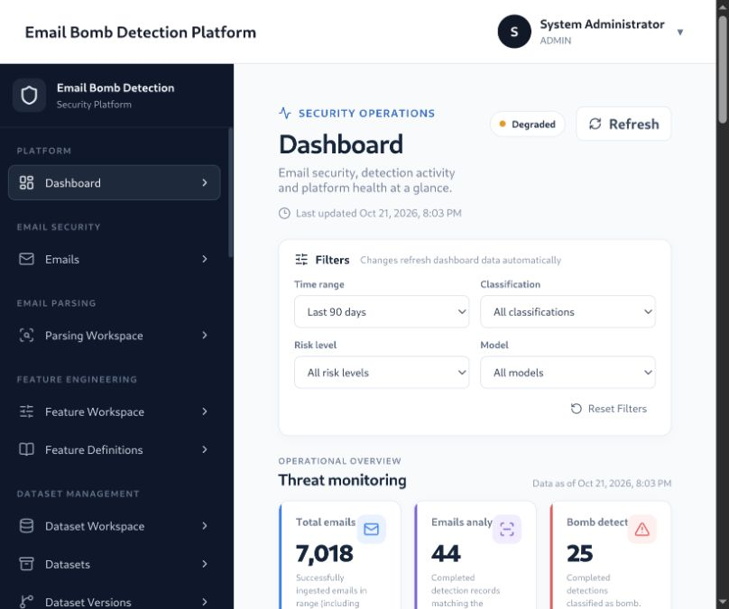
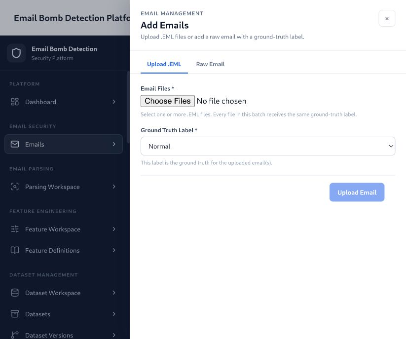
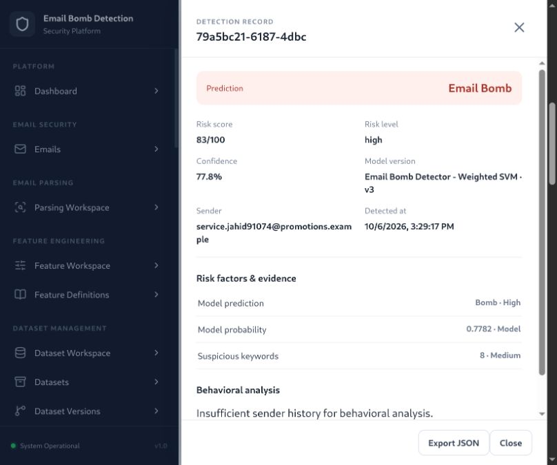
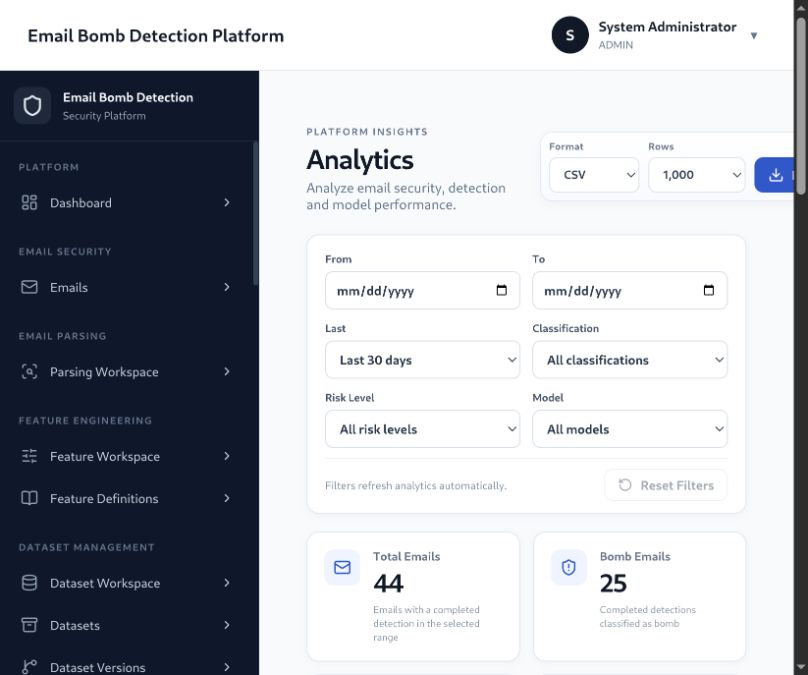
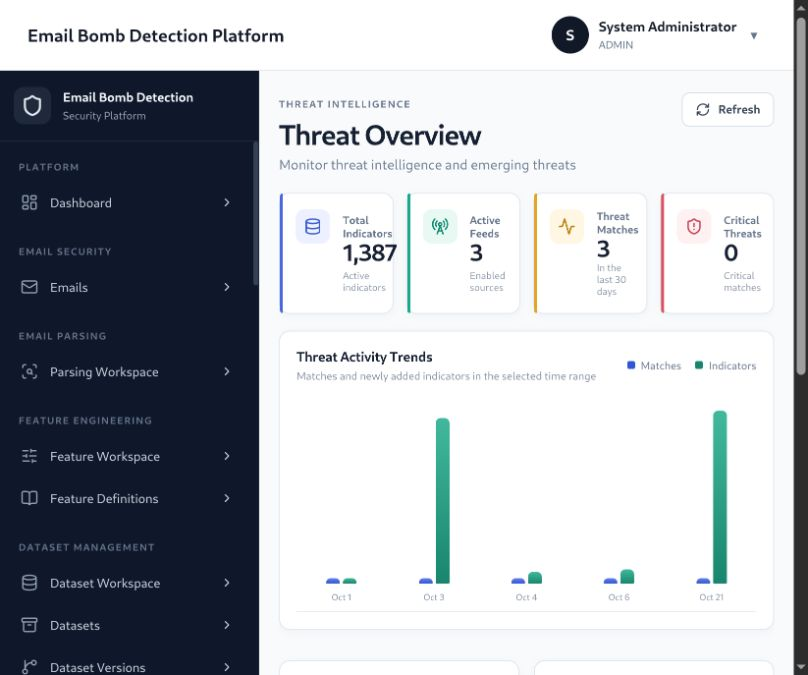
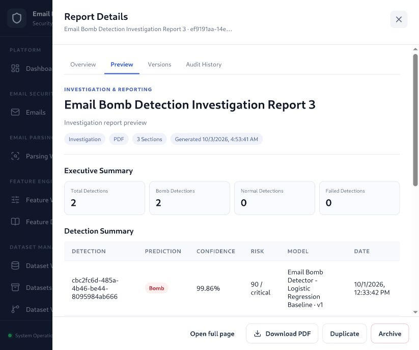

<!-- ========================================================= -->
<!-- Hero -->
<!-- ========================================================= -->

<h1 align="center">📧 Email Bomb Detection Platform</h1>

<p align="center">
  <strong>An end-to-end platform for ingesting, detecting, and investigating email-bomb activity.</strong>
</p>

<p align="center">
  Email Ingestion · Parsing · Machine Learning · Risk Analysis · Threat Intelligence · Investigation
</p>

<p align="center">
  
</p>

<p align="center">
  
  
  
  
  
  
</p>

---

## Table of Contents

- [Overview](#overview)
- [Features](#features)
- [Detection workflow](#detection-workflow)
- [Authentication and roles](#authentication-and-roles)
- [Project structure](#project-structure)
- [Installation and local development](#installation-and-local-development)
- [Testing](#testing)
- [Security notes](#security-notes)
- [Contributing](#contributing)
- [License](#license)
- [Author](#author)

---

## Overview

The **Email Bomb Detection Platform** provides a web interface and API for collecting and analyzing email, classifying suspicious messages, and reviewing detection evidence. Its workflow connects email ingestion and parsing with feature engineering, machine-learning model management, detection, risk analysis, and investigation reports.

The application is built with a React frontend and a FastAPI backend, with SQLite as the default database.

---

## Features

Screenshots below are placed with the feature they show. They were captured from the local development UI and may include sample records.

### Dashboard

The dashboard gives analysts a quick view of platform activity and detection summaries.



### Email intake and management

- Ingest email messages and `.eml` files.
- Parse and normalize email content and metadata.
- Extract and manage detection features.



### Detection and risk analysis

- Classify messages as normal or email bomb with registered ML models.
- Review detection history, confidence, model information, and evidence.
- Examine risk factors and behavioral-analysis results.



### Analytics

Use analytics to summarize detections, classification rates, model performance, and risk distribution.



### Threat intelligence

Review indicators, feeds, severity, and email-to-indicator matches to add context to investigations.



### Investigation and reporting

- Review explainability and evidence for detections.
- Create and preview investigation reports, including PDF and JSON exports.



### Data and model workflow

- Create and manage datasets and dataset versions.
- Validate data and manage preprocessing runs.
- Manage ML models, training runs, evaluations, and the model registry.
- Track experiments and compare model results.

### Administration and audit

- Manage users, roles, sessions, settings, and security audit records.

## Detection workflow

```text
Email source or uploaded .eml
            │
            ▼
     Parse and normalize
            │
            ▼
      Extract features
            │
            ▼
   Preprocess and classify
            │
            ▼
 Risk and behavioral analysis
            │
            ▼
 Review evidence and report
```

Threat intelligence can add indicator context to email investigations. Detection output is intended to support analyst review.

---

## Authentication and roles

The application provides authenticated API access, user and session management, role-based permissions, password administration, and audit records for administrative actions.

| Role | Purpose |
|---|---|
| `ADMIN` | Administrative access and user/platform management |
| `SECURITY_ANALYST` | Security operations and investigation access |
| `EMAIL_ANALYST` | Email-analysis workflows |
| `VIEWER` | Read-oriented access granted by permissions |

---

## Project structure

```text
Email-Bomb-Detection-Platform/
├── backend/
│   ├── app/
│   │   ├── common/                # Shared schemas, responses, dependencies, pagination
│   │   ├── core/                  # Settings, database, security, RBAC, logging, registry
│   │   └── modules/
│   │       ├── analytics/         # Detection and platform analytics
│   │       ├── audit_security_admin/
│   │       │   ├── administration/
│   │       │   ├── audit/
│   │       │   └── security_monitoring/
│   │       ├── auth/              # Login, tokens, and user sessions
│   │       ├── dashboard/        # Dashboard summaries and integrations
│   │       ├── datasets/         # Dataset lifecycle and validation
│   │       ├── detection/
│   │       │   ├── behavioral/   # Behavioral analysis
│   │       │   └── risk/         # Detection risk assessments
│   │       ├── emails/           # Email records, ingestion, and collection
│   │       ├── experiments/      # ML experiment tracking
│   │       ├── features/         # Email feature definitions and extraction
│   │       ├── investigation_reporting/
│   │       │   ├── evidence/
│   │       │   ├── explainability/
│   │       │   └── reporting/
│   │       │       └── generators/ # PDF and JSON report generation
│   │       ├── ml_models/
│   │       │   ├── config/
│   │       │   ├── engine/
│   │       │   ├── evaluation/
│   │       │   ├── registry/
│   │       │   └── storage/
│   │       ├── parsing/          # Email parsing and normalization
│   │       ├── preprocessing/
│   │       │   ├── config/
│   │       │   ├── engine/
│   │       │   └── storage/
│   │       ├── settings/         # Application and user settings
│   │       ├── threat_intelligence/
│   │       │   └── integrations/ # Threat feed integrations
│   │       └── users/            # Accounts, roles, and user administration
│   ├── alembic/
│   │   └── versions/             # Database schema migrations
│   └── tests/
│       ├── integration/
│       └── modules/              # Tests grouped by backend module
├── frontend/
│   ├── package.json                # Frontend dependencies and scripts
│   └── src/
│       ├── core/
│       │   ├── api/                # API client and error handling
│       │   ├── auth/               # Frontend authentication state
│       │   ├── components/
│       │   ├── layout/             # Header, sidebar, application shell
│       │   ├── permissions/
│       │   ├── registry/
│       │   └── router/
│       ├── modules/
│       │   ├── analytics/
│       │   ├── audit-security-admin/
│       │   ├── auth/
│       │   ├── dashboard/
│       │   ├── datasets/
│       │   ├── detection/
│       │   ├── emails/
│       │   ├── experiments/
│       │   ├── features/
│       │   ├── investigation-reporting/
│       │   ├── ml-models/
│       │   ├── parsing/
│       │   ├── preprocessing/
│       │   ├── settings/
│       │   ├── threat_intelligence/
│       │   └── users/
│       └── shared/
│           ├── components/
│           ├── feedback/
│           ├── forms/
│           ├── layouts/
│           ├── modals/
│           ├── tables/
│           └── utils/
├── images/                          # README banner and screenshots
├── src/
│   └── generators/                  # Sample email generators
├── .env.example                     # Example environment settings
├── alembic.ini                      # Alembic entry-point configuration
├── package.json                     # Root development scripts
└── requirements.txt                 # Backend Python dependencies
```

---

## Installation and local development

### 1. Clone the repository

```bash
git clone https://github.com/sahadatx/Email-Bomb-Detection-Platform.git
cd Email-Bomb-Detection-Platform
```

### 2. Install backend dependencies

```bash
python3 -m venv .venv
source .venv/bin/activate
python -m pip install --upgrade pip
python -m pip install -r requirements.txt
```

On Windows PowerShell, use this instead:

```powershell
py -m venv .venv
.venv\Scripts\Activate.ps1
python -m pip install --upgrade pip
python -m pip install -r requirements.txt
```

### 3. Install frontend dependencies and migrate the database

```bash
npm install
npm --prefix frontend install
alembic upgrade head
```

### 4. Start the application

```bash
npm run dev
```

On macOS or Linux, this starts the FastAPI backend on port `8000` and the Vite frontend on port `5173`. Open <http://localhost:5173> in a browser. The frontend proxies `/api` requests to the backend.

The root `npm run dev` shortcut uses Bash and `.venv/bin`, so on Windows PowerShell start the services in separate terminals instead. In the first terminal, from the repository root, run:

```powershell
.venv\Scripts\Activate.ps1
$env:PYTHONPATH = "backend"
python -m uvicorn app.main:app --reload --host 0.0.0.0 --port 8000
```

In a second terminal, run:

```powershell
npm --prefix frontend run dev
```

## Testing

Run backend tests from the repository root with the virtual environment active:

```bash
PYTHONPATH=backend pytest -q
```

Run frontend tests and create a production build with:

```bash
npm --prefix frontend test
npm --prefix frontend run build
```

---

## Security notes

- Do not commit `.env`, credentials, access tokens, or private email content.
- Replace development secrets before deploying outside a local environment.
- Use HTTPS and restrict database and administrative access in production.
- Apply least-privilege roles and review audit records for sensitive actions.
- Treat model predictions as decision support and verify important findings during investigation.

---

## Contributing

Contributions are welcome. Please keep changes consistent with the existing module structure, add or update relevant tests, and document user-visible behavior. Before opening a pull request, run the backend tests and frontend checks listed above.

---

## License

No license file is currently included in this repository. Add a `LICENSE` file to define the terms for use and redistribution.

---

## Author

**Sahadat Hossain**

Cybersecurity Researcher • Penetration Tester • Python Developer

### Contact

- 📧 **Email:** [pentester.sahadathossain@gmail.com](mailto:pentester.sahadathossain@gmail.com)
- 💼 **LinkedIn:** [linkedin.com/in/pentester-sahadat-hossain](https://www.linkedin.com/in/pentester-sahadat-hossain/)
- 🐙 **GitHub:** [github.com/sahadatx](https://github.com/sahadatx)
- 🌐 **Portfolio:** [sahadatx.github.io/Personal-Portfolio](https://sahadatx.github.io/Personal-Portfolio/)

> Feel free to connect for collaboration, security research, or open-source contributions.

---

If you found this project useful, consider supporting it by:

- ⭐ Starring the repository
- 🍴 Forking the project
- 🤝 Contributing improvements
- 📢 Sharing it with others

---

<p align="center">
Made with ❤️ by <strong>Sahadat Hossain</strong>
</p>

<p align="right">
<a href="#-overview">⬆️ Back to Top</a>
</p>
